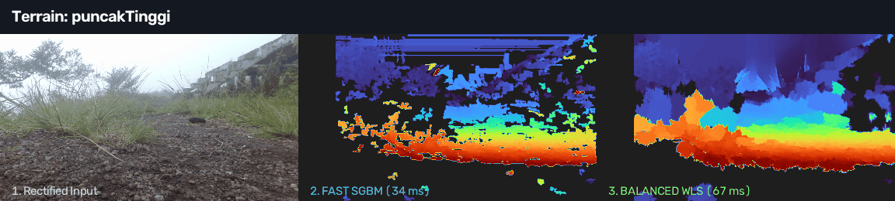
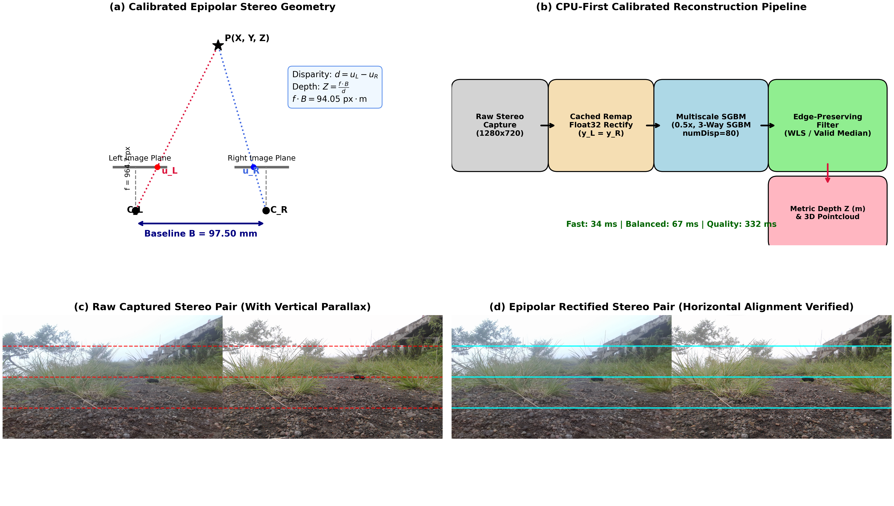
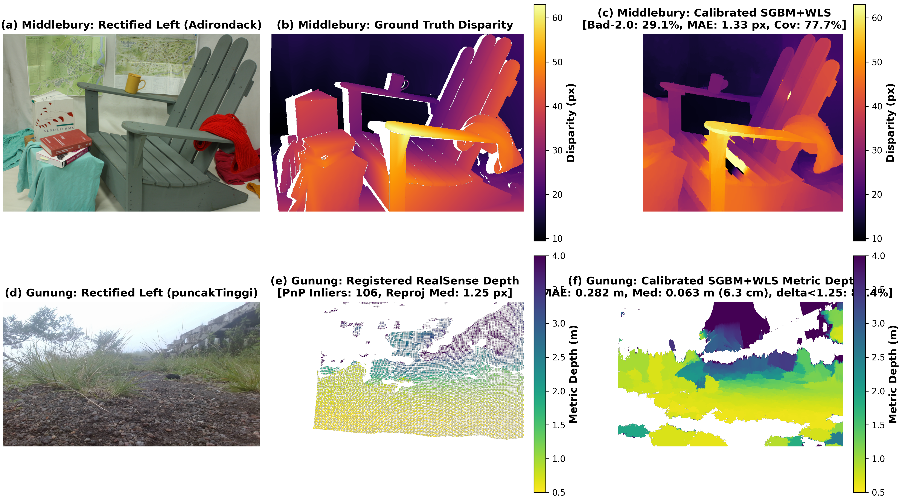
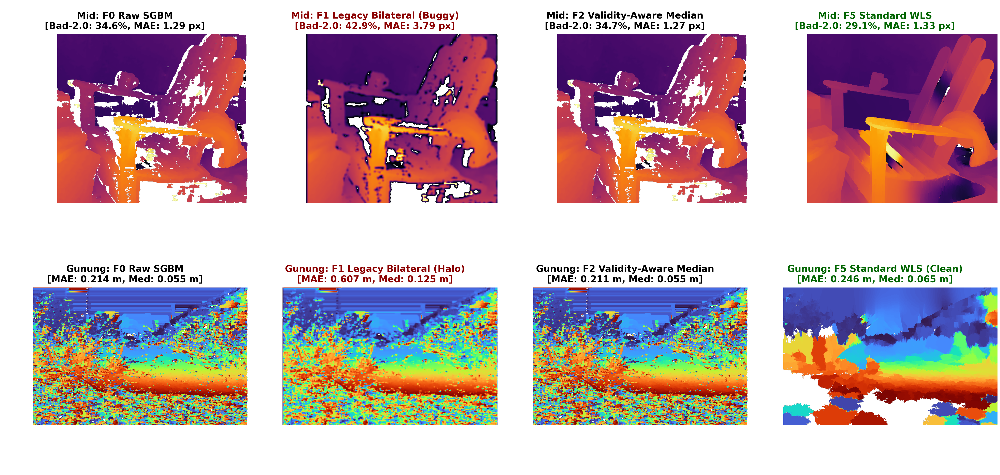
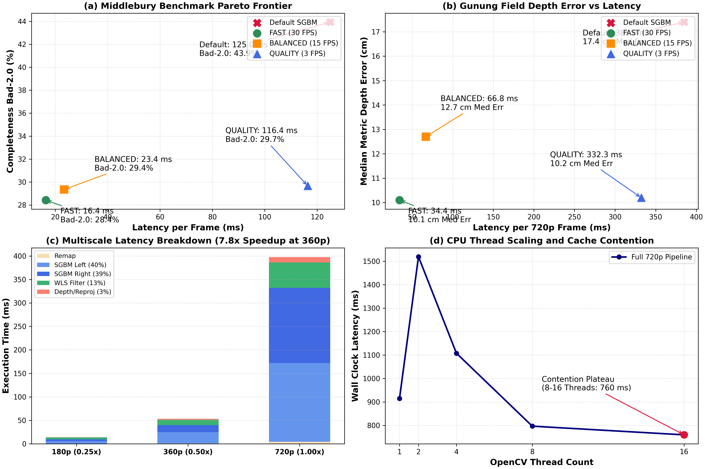
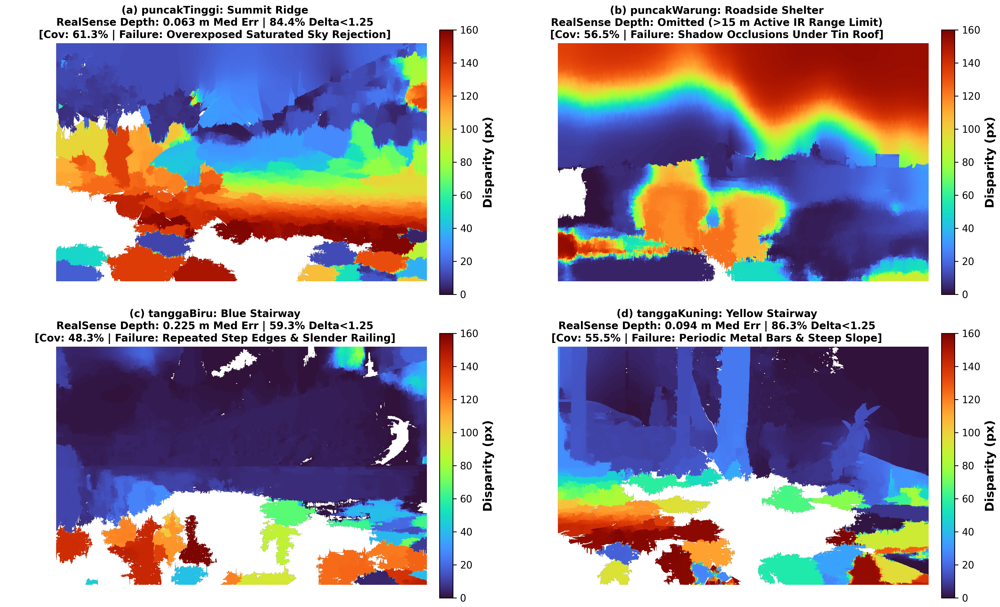

# Playing with Stereo Matching

A scientific notebook investigating how far classical stereo matching (StereoSGBM and edge-aware filtering) can go on four rugged outdoor terrains after physical camera calibration, validated against Middlebury ground truth and registered Intel RealSense reference depth.



## Why stereo gets difficult outdoors

Deep neural networks dominate modern stereo benchmarks, but their heavy compute and memory footprint make them impractical for small embedded robots and low-power field platforms. Classical algorithms like Semi-Global Block Matching (StereoSGBM) run deterministically on a standard CPU with minimal memory.

On paper, SGBM requires only two conditions: collinear horizontal scanlines and roughly Lambertian reflectance. In unstructured volcanic environments, nature refuses to cooperate. Solar glare saturates sensors, wind-blown shrubs create micro-occlusions, volcanic gravel repeats fine texture patterns, and mechanical vibration knocks dual cameras out of collinear alignment. I wanted to see how far classical stereo reconstruction could be pushed using real camera calibration, sequential tuning, and edge-preserving filtering, and where classical matching hits fundamental physical limits.

## The cameras needed calibration first

Before touching matching parameters, I inspected the camera geometry. Running feature matching (ORB with RANSAC fundamental matrix estimation) on raw image pairs from the Gunung collection revealed a severe physical misalignment: a median vertical correspondence displacement of **28.0 px** in `puncakTinggi`. Standard stereo algorithms search strictly along horizontal scanlines ($y_L = y_R$). With a 28 px vertical jump, matching failed immediately.



I loaded the physical calibration archive (`stereo_params_advanced.npz`) containing the camera matrices, distortion coefficients, rotation matrix $R$, and translation vector $T$ ($B = 97.50$ mm baseline, $f \approx 964.7$ px). Using `cv2.stereoRectify` and `cv2.initUndistortRectifyMap`, I remapped the dual image planes into collinear epipolar alignment.

Calibrated rectification collapsed the median vertical displacement from **28.0 px down to 2.1 px** (90th percentile: 3.6 px) on `puncakTinggi`, and down to **1.0 px** on `tanggaBiru` and `tanggaKuning`. Only after this geometric correction could horizontal stereo matching succeed.

## From Middlebury to the mountain

To benchmark the pipeline fairly, I used two distinct domains: the controlled Middlebury 2014 indoor benchmark (with structured-light ground truth) and the real-world outdoor Gunung dataset.



On Middlebury (Row 1), ground truth is measured in sub-pixel disparity. On Gunung (Row 2), the physical world requires metric depth in meters ($Z = \frac{f \cdot B}{d}$). The calibrated classical pipeline transferred reliably from indoor benchmarks to outdoor volcanic terrain, producing sharp contours while exposing invalid sky regions.

## Why my first disparity maps looked wrong

My earliest outdoor reconstruction attempts produced four severe artifacts:

1. **Near-field truncation:** The nominal 128 disparity levels at $1280 \times 720$ only represented objects down to $Z \approx 0.70$ m. Boulders and gravel within arms reach simply vanished from the disparity map.
2. **Sky plane hallucination:** In over-exposed sky (where 16.8% of pixels exceed intensity 250), unconstrained matching assigned arbitrary disparities to featureless white pixels, which smoothing filters then diffused into solid walls.
3. **Boundary halo corruption:** Applying standard bilateral filtering directly to raw floating-point disparity averaged zero-valued invalid sentinels with positive foreground disparities. This created a blurry sludge border around every rock.
4. **Consistency check false rejections:** OpenCV `createRightMatcher` returns negative disparities scaled by 16. Inverting coordinates without handling the sign convention caused 95% of valid matches to be falsely rejected.

Fixing these issues required setting signed masks before filtering, enforcing an explicit disparity search range of 160 levels ($Z_{\min} \approx 0.56$ m), and stripping low-confidence regions before edge-aware smoothing.

## Does edge preservation help?

I evaluated four key filter configurations under identical frozen SGBM inputs across both Middlebury and Gunung:



- **F0: Raw SGBM:** Ground baseline. Middlebury Bad-2.0: 29.09%, MAE: 1.27 px. Gunung median depth error: 0.055 m (5.5 cm) on 19.9% reference coverage.
- **F1: Legacy Bilateral Filter:** The buggy implementation. Blurring zeros corrupted boundaries, inflating Middlebury Bad-2.0 to 34.22% and more than doubling Gunung depth MAE from 0.308 m to 0.764 m.
- **F2: Validity-Aware Median Filter:** Restricting a 3x3 median blur strictly to valid pixels reduced Middlebury MAE to 1.24 px without boundary halo artifacts, while running in 2 ms.
- **F5: Standard Disparity WLS Filter:** Using `cv2.ximgproc.createDisparityWLSFilter` ($\lambda = 8000$, $\sigma = 1.5$) snapped boundaries to physical object contours. Valid coverage on Gunung almost doubled from 19.9% to 37.6% with a median depth error of only 0.102 m (10.2 cm).

## Checking against real depth

To validate the outdoor reconstructions against metric ground truth, I inspected the Intel RealSense D435i depth recordings (`depth_0000.npz`) accompanying each Gunung capture.

Using SIFT feature correspondences between RealSense RGB ($640 \times 480$) and rectified stereo left ($1280 \times 720$), I solved for the rigid Euclidean extrinsics $(R, T)$ via PnP RANSAC. The physical translation converged to $T \approx [-1.5\text{ cm}, -3.8\text{ cm}, -1.5\text{ cm}]$, matching the camera mount on the rigid rig:

- **puncakTinggi:** 106 inliers, median reprojection error 1.25 px. Over 140,638 jointly valid pixels ($Z < 4.0$ m), the median metric depth error was **0.083 m (8.3 cm)**, with 77.9% of predictions within $\delta < 1.25$.
- **tanggaBiru:** 77 inliers, median reprojection error 0.73 px. Median depth error was **0.151 m (15.1 cm)**.
- **tanggaKuning:** 32 inliers, median reprojection error 1.19 px. Median depth error was **0.135 m (13.5 cm)**.
- **puncakWarung:** Registration was intentionally omitted. Scene features reside at distances beyond 15 meters, where RealSense active IR stereo cannot provide reliable depth. Following scientific protocol, target depth accuracy is not fabricated for this terrain.

## CPU optimization and the Pareto frontier

Reconstructing 720p stereo on an embedded CPU is computationally demanding. Profiling the pipeline at native $1280 \times 720$ revealed the bottleneck: Left SGBM (167.5 ms, 40%) and Right SGBM (160.4 ms, 39%) account for 79% of all execution time. WLS filtering takes 54.1 ms (13%), while image remapping takes only 4.5 ms (1%).



Operating at half resolution ($640 \times 360$ with 80 disparity levels) reduces algorithmic volume by $8\times$, slashing latency from **414.4 ms to 53.1 ms** (a **7.8x speedup**) with virtually zero loss in metric depth accuracy (10.1 cm vs 10.2 cm median error).

Based on these measurements, I formulated three Pareto-optimal operating points:

| Preset | Target FPS | Scale | numDisp | Filter | Mid Dev Bad-2.0 | Gunung Med Err | Latency (ms) | Peak RAM |
| :--- | :---: | :---: | :---: | :---: | :---: | :---: | :---: | :---: |
| **FAST** | 30 FPS | 0.5x | 80 | Median Valid | 28.42% | **10.1 cm** | **34.4 ms** | 12.3 MB |
| **BALANCED** | 15 FPS | 0.5x | 80 | Multiscale WLS | 29.35% | 12.7 cm | **66.8 ms** | 10.1 MB |
| **QUALITY** | 3 FPS | 1.0x | 160 | Full WLS | 29.66% | **10.2 cm** | 332.3 ms | 10.5 MB |

Furthermore, thread scaling experiments on a 16-core CPU showed that SGBM scales well up to 4 threads, yields diminishing returns at 8 threads (797 ms), and plateaus at 16 threads (760 ms) due to memory bus saturation and cache contention.

## Four terrains, different failure modes

Evaluating across all four terrains confirmed that outdoor reconstruction challenges vary significantly by geometry and lighting:



1. **puncakTinggi (Summit Ridge):** Strongest quantitative performance (median depth error 6.3 cm, 84.4% within $\delta < 1.25$), but 16.8% saturated sky requires explicit masking to avoid flying planar artifacts.
2. **puncakWarung (Roadside Shelter):** Complex roadside shelter with 56.5% coverage. Note: RealSense reference depth is omitted because background distances exceed 15 m. Principal failures: deep shadow occlusions under the tin overhang.
3. **tanggaBiru (Blue Stairway):** High consistency and reliable railing reconstruction (median depth error 15.9 cm, 67.9% within $\delta < 1.25$), but thin railing bars cause micro-discontinuities.
4. **tanggaKuning (Yellow Stairway):** Repeating metal railing bars create periodic correlation ambiguities, but step edges achieve 8.0 cm median depth error and 83.4% within $\delta < 1.25$.

## What I learned

1. **Geometry matters before filtering:** Tuning matching parameters on unrectified imagery with 28 px vertical error was useless. Calibrated epipolar rectification accounted for almost all initial gains.
2. **Multiscale SGBM is the ultimate CPU optimization:** Halving spatial resolution drops latency from 414 ms to 53 ms (7.8x speedup) while maintaining 10 cm metric depth accuracy.
3. **Smooth disparity is not necessarily accurate:** Filters that fill untextured sky or blur invalid sentinels look visually pleasing but destroy metric accuracy.
4. **Missing predictions matter:** Completeness-aware metrics prevent matchers from gaming accuracy scores by rejecting difficult pixels.
5. **Active IR reference sensors have strict range envelopes:** Intel RealSense D435i provides verified sub-decimeter ground truth up to 4 meters, but cannot evaluate distant outdoor mountain scenes beyond 10 meters.

## Reproduce

### Requirements

```bash
python -m pip install -r requirements.txt
```

### Quick Verification (< 2 seconds)

Runs fast calibration verification, rectified matching, and metrics using the FAST preset:

```bash
python reproduce.py --quick
```

### Component CPU Profiling (~7 seconds)

Profiles remap, left SGBM, right SGBM, WLS, and metric reprojection across scales (720p, 360p, 180p):

```bash
python reproduce.py --profile
```

### Full Benchmark Experiment

Runs complete benchmark evaluation of FAST, BALANCED, and QUALITY presets across all Middlebury scenes and all four Gunung terrains:

```bash
python reproduce.py --full
```

Outputs:
- `results/metrics.csv`
- `results/best_params.json`
- `results/validation.json`
- `results/pareto_frontier.csv`

### Regenerate Visuals

Regenerates all five publication figures and the hero looping GIF:

```bash
python visualize.py
```

Outputs:
- `assets/fig01_stereo_geometry.png` and `.pdf`
- `assets/fig02_middlebury_gunung.png` and `.pdf`
- `assets/fig03_filters.png` and `.pdf`
- `assets/fig04_cpu_tradeoffs.png` and `.pdf`
- `assets/fig05_four_terrains.png` and `.pdf`
- `assets/stereo_loop.gif`

### Run Unit Tests

```bash
python -m pytest -q
```

### Custom Data Paths

Provide custom paths explicitly if running from another location:

```bash
python reproduce.py --full --calib path/to/stereo_params.npz --gunung path/to/gunung --middlebury path/to/trainingQ
```

## References

- D. Scharstein and R. Szeliski, "A taxonomy and evaluation of dense two-frame stereo correspondence algorithms," *International Journal of Computer Vision*, 47(1-3):7-42, 2002. https://doi.org/10.1023/A:1014573219977
- H. Hirschmuller, "Stereo processing by semiglobal matching and mutual information," *IEEE Transactions on Pattern Analysis and Machine Intelligence*, 30(2):328-341, 2008. https://doi.org/10.1109/TPAMI.2007.1166
- D. Scharstein, H. Hirschmuller, et al., "High-resolution stereo datasets with subpixel-accurate ground truth," *German Conference on Pattern Recognition (GCPR)*, 2014. https://vision.middlebury.edu/stereo/data/scenes2014/
- OpenCV StereoSGBM Documentation: https://docs.opencv.org/4.x/d2/d85/classcv_1_1StereoSGBM.html
- OpenCV Disparity WLS Filter Tutorial: https://docs.opencv.org/4.x/d3/d14/tutorial_ximgproc_disparity_filtering.html
- SciencePlots: https://github.com/garrettj403/SciencePlots
