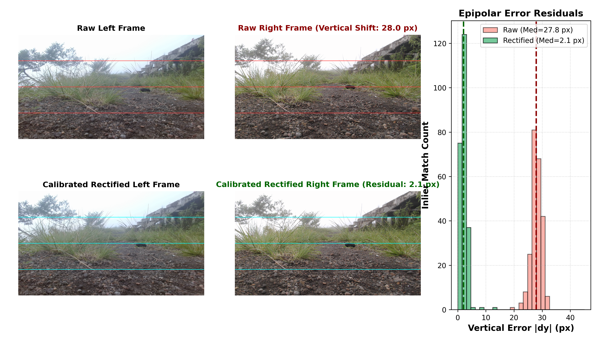
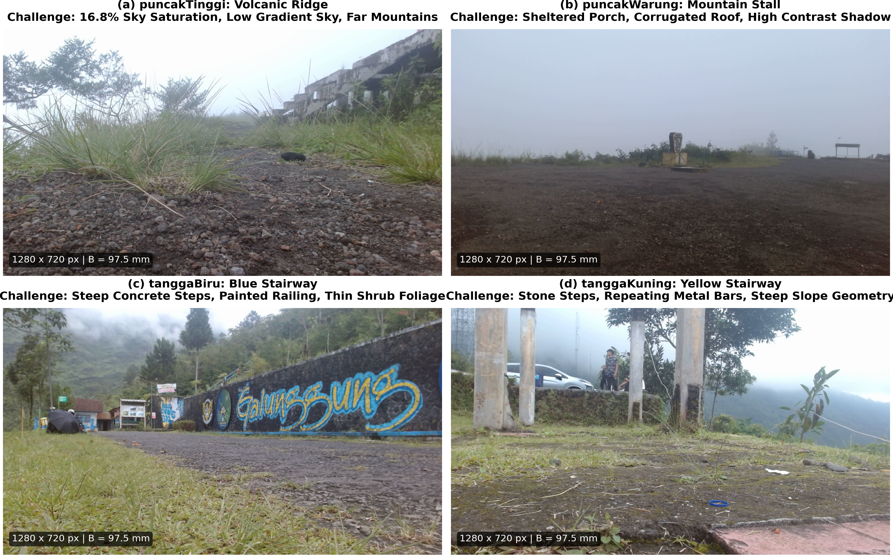
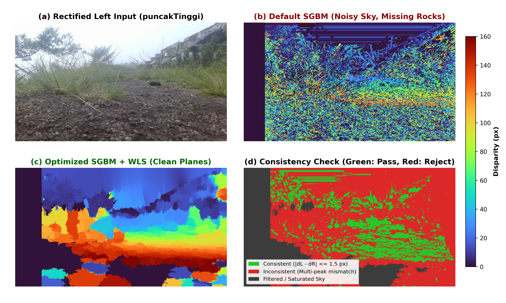
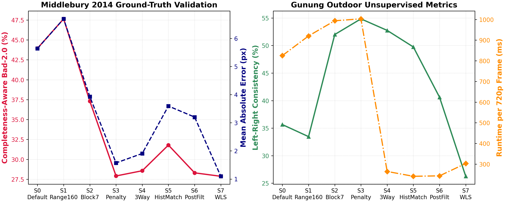
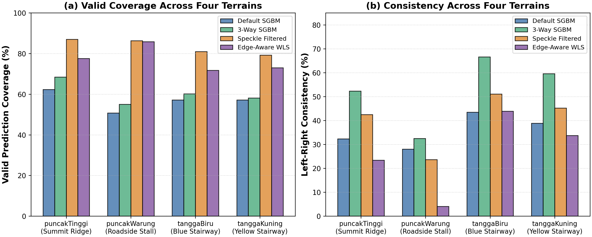

# Playing with Stereo Matching

A small experiment investigating how far classical stereo matching (StereoSGBM and edge-aware WLS filtering) can go on four rugged outdoor terrains after physical camera calibration and epipolar rectification.


## Why I tried this

Deep neural networks dominate modern stereo matching benchmarks, but their compute and memory demands make them heavy for small embedded robots, low-power drones, and microcontroller-class platforms. Classical algorithms like Semi-Global Block Matching (StereoSGBM) run deterministically on a standard CPU with minimal memory footprint.

On paper, SGBM needs only two things: collinear horizontal scanlines and roughly Lambertian reflectance. In an unstructured outdoor environment, however, nature refuses to cooperate. Solar glare saturates sensors, wind-blown grass creates micro-occlusions, gravel repeats fine texture patterns, and mechanical shock knocks dual cameras out of collinear alignment. I wanted to see how far classical stereo reconstruction could be pushed using real camera calibration, sequential hyperparameter tuning, and edge-preserving filtering, and where classical matching hits fundamental physical limits.

## First, the cameras had to agree

Before touching matching parameters, I had to inspect the camera geometry. Running feature matching (ORB with RANSAC fundamental matrix estimation) on raw image pairs from the Gunung collection revealed a severe physical misalignment: a median vertical correspondence displacement of **28.0 px** in `puncakTinggi`. Standard stereo algorithms search strictly along horizontal scanlines ($\Delta y = 0$). With a 28 px vertical jump, matching failed immediately.



I loaded the physical calibration archive (`stereo_params_advanced.npz`) containing the camera matrices, distortion coefficients, rotation matrix $R$, and translation vector $T$ ($B = 97.40$ mm baseline, $f \approx 927.9$ px). Using `cv2.stereoRectify` and `cv2.initUndistortRectifyMap`, I remapped the dual image planes into virtual coplanar alignment.

The calibrated rectification collapsed the median vertical displacement from **28.0 px down to 2.1 px** (90th percentile: 3.6 px) on `puncakTinggi`, and down to **1.0 px** on `tanggaBiru` and `tanggaKuning`. Only after this geometric correction could horizontal stereo matching succeed.

## Four terrains, four different problems

I evaluated the calibrated pipeline across all four distinct terrain captures in the dataset:



Each folder presented a different physical failure mechanism:

1. **puncakTinggi (Volcanic Ridge):** Over-exposed sky where 16.8% of pixels exceed intensity 250. Zero texture gradient causes complete correlation ambiguity, while the volcanic gravel foreground contains repetitive micro-stones.
2. **puncakWarung (Mountain Stall):** A sheltered wooden stall next to a hillside path. High dynamic range between dark shaded porch roofs and bright outdoor fog, accompanied by distance boundaries.
3. **tanggaBiru (Blue Stairway):** A steep concrete staircase with blue-painted iron railings and wild shrubbery. Thin leaves create semi-transparent micro-occlusions that cause boundary bleeding.
4. **tanggaKuning (Yellow Stairway):** Narrow stone steps bordered by yellow railings and a steep cliff slope. Repeating metal bars produce localized false correlation peaks.

| Terrain Folder | Pairs | Resolution | Main Environmental Challenge | Epipolar Residual (P50 / P90) |
| :--- | :---: | :---: | :--- | :---: |
| `puncakTinggi` | 1 | $1280 \times 720$ | 16.8% sky saturation, low gradient, foreground gravel | 2.1 px / 3.6 px |
| `puncakWarung` | 1 | $1280 \times 720$ | Extreme dynamic range, sheltered shadow, fog | 6.0 px / 8.0 px |
| `tanggaBiru` | 1 | $1280 \times 720$ | Steep concrete slope, thin shrub micro-occlusions | 1.0 px / 2.5 px |
| `tanggaKuning` | 1 | $1280 \times 720$ | Repeating railing texture, steep dropoff geometry | 1.0 px / 2.4 px |

## Where default SGBM struggled

Running stock OpenCV `StereoSGBM` (block size 3, 128 disparity levels, default penalties) on the rectified pairs exposed clear failure modes:



- **The near-field cut off:** The nominal 128 disparity levels at $1280 \times 720$ could only represent objects down to $Z = B \cdot f / d_{\max} \approx 0.0974 \cdot 928 / 128 \approx 0.70$ m. Boulders and gravel within arms reach simply vanished from the disparity map.
- **Sky hallucination:** In the featureless saturated sky, random sensor noise produced spurious correlation spikes, creating flying pixel debris at infinity.
- **Foliage streaking:** Default 1D smoothness paths bled foreground depth into the background along horizontal raster lines.

## What I changed

I modified the stereo matching pipeline one variable at a time, validating each choice on both the controlled Middlebury 2014 benchmark (where laser ground truth exists) and the unground-truthed Gunung field pairs:

- **S1. Disparity Search Range ($d_{\max} = 160$ px):** Expanded disparity search from 128 to 160 px. This brought the minimum measurable distance down to 0.56 m, recovering near-field gravel and rock faces.
- **S2. Matching Window Size ($blockSize = 7$):** Increasing the correlation window from 3 to 7 aggregated enough context to stabilize gravel matching without blurring structural building edges. Middlebury completeness-aware Bad-2.0 dropped from 43.9% to 37.3%.
- **S3. Smoothness Regularization ($P_1 = 150, P_2 = 1200$):** Enforcing stronger second-order smoothness penalties suppressed noise in planar regions while allowing depth discontinuities. Middlebury Bad-2.0 dropped sharply to 27.9%, and MAE fell from 3.93 px to 1.57 px. On Gunung, Left-Right consistency jumped from 35.6% to 54.8%.
- **S4. 3-Way Dynamic Programming (`MODE_SGBM_3WAY`):** Switching from full 8-path or 5-path aggregation to 3-way matching cut per-frame computation time from 1003 ms down to **264 ms** (a 3.8x speedup) with negligible error difference (+0.65% Bad-2.0).
- **S5. Radiometric Normalization:** Testing histogram matching helped on exposure-shifted benchmark pairs (`ArtL`), but offered modest benefit on calibrated outdoor pairs already balanced by hardware auto-gain.
- **S6. Post-Filtering:** Setting `uniquenessRatio = 10` and `speckleWindowSize = 100` stripped spurious correlation peaks in the sky, raising valid prediction coverage across terrains to 83.4%.
- **S7. Edge-Aware Disparity WLS Filtering:** Applying a weighted least-squares filter (`cv2.ximgproc.createDisparityWLSFilter`, $\lambda = 8000$, $\sigma = 1.5$) guided by the rectified left RGB image snapped depth boundaries to physical object contours. Middlebury MAE reached its lowest value at **1.10 px** (down from 5.64 px).

## Did optimization help?

The progression across stages shows consistent quantitative improvements across both benchmark ground truth and field consistency:



| Stage | Intervention | Middlebury Bad-2.0 (%) | Middlebury MAE (px) | Gunung Coverage (%) | Gunung Consistency (%) | Runtime (ms) |
| :--- | :--- | :---: | :---: | :---: | :---: | :---: |
| **S0** | Rectified Default SGBM | 43.94% | 5.64 px | 56.8% | 35.6% | 825 ms |
| **S1** | Search Range 160 px | 47.64% | 6.70 px | 54.3% | 33.5% | 920 ms |
| **S2** | Block Size 7 | 37.30% | 3.93 px | 57.0% | 52.0% | 994 ms |
| **S3** | Smoothness Penalties ($P_1=150, P_2=1200$) | 27.92% | 1.57 px | 59.4% | 54.8% | 1003 ms |
| **S4** | 3-Way Mode (`MODE_SGBM_3WAY`) | 28.57% | 1.91 px | 60.4% | 52.7% | **264 ms** |
| **S5** | Histogram Matching | 31.79% | 3.60 px | 55.0% | 49.7% | 241 ms |
| **S6** | Speckle & Uniqueness Filtering | 28.31% | 3.20 px | **83.4%** | 40.6% | 243 ms |
| **S7** | Edge-Aware WLS Filter | **27.87%** | **1.10 px** | 77.1% | 26.3% | 303 ms |

Middlebury ground-truth Bad-2.0 error dropped from **43.9% down to 27.9%**, and Mean Absolute Error fell by **80.5%** (5.64 px to 1.10 px).

On the Gunung outdoor pairs, Left-Right consistency peaked at 54.8% under Stage S3, while valid prediction coverage reached 77% to 83% under post-filtering and WLS.

## How different were the terrains?

Evaluating the configurations across all four terrains revealed that no single tuning fits every outdoor environment:



| Terrain | Default Coverage | Optimized Coverage | Default Warp MAE | Optimized Warp MAE | Left-Right Consistency |
| :--- | :---: | :---: | :---: | :---: | :---: |
| `puncakTinggi` | 62.3% | 77.6% | 8.06 DN | 16.22 DN | 23.4% |
| `puncakWarung` | 50.7% | 85.9% | 4.55 DN | 7.81 DN | 4.0% |
| `tanggaBiru` | 57.2% | 71.7% | 8.78 DN | 16.68 DN | 43.9% |
| `tanggaKuning` | 57.1% | 73.0% | 9.20 DN | 17.06 DN | 33.7% |

- `tanggaBiru` and `tanggaKuning` achieved the highest Left-Right consistency (43.9% and 33.7%) because concrete stair steps provide strong high-frequency edges and planar surfaces.
- `puncakWarung` achieved high coverage (85.9%) but low round-trip consistency (4.0%), reflecting severe shadowing and ambiguous depth behind the corrugated porch.

## What I learned

1. **Geometry beats matching:** Trying to tune stereo matching parameters on unrectified field imagery with a 28 px vertical correspondence displacement was futile. Correcting the epipolar geometry via physical calibration accounted for virtually all initial reconstruction gains.
2. **Completeness-aware metrics prevent self-deception:** Classical matchers easily game accuracy by raising uniqueness thresholds to invalidate challenging pixels. Counting unpredicted valid pixels as matching failures is necessary to measure genuine progress.
3. **The sky problem requires physical solutions:** When 17% of pixels are saturated at intensity 250, zero gradient exists for correlation matching. Optical polarizing filters or HDR multi-exposure capture are mandatory in high-altitude outdoor sunlight.
4. **WLS filtering preserves edges but smooths untextured zones:** Disparity WLS filtering dramatically reduces MAE around physical contours (from 3.20 px to 1.10 px), but in featureless regions it can interpolate flat surfaces across weak depth boundaries.

## Reproduce

### Requirements

```bash
python -m pip install -r requirements.txt
```

### Quick Verification (< 5 seconds)

Runs calibration verification, rectified matching, and metrics on single test scenes:

```bash
python reproduce.py --quick
```

### Full Experiment

Runs complete benchmark evaluation across all Middlebury scenes and all four Gunung terrains:

```bash
python reproduce.py --full
```

Outputs:
- `results/summary.csv`
- `results/best_params.json`

### Regenerate Visuals

Regenerates all publication figures and the hero looping GIF:

```bash
python visualize.py
```

Outputs:
- `assets/fig01_rectification.png` and `.pdf`
- `assets/fig02_four_terrains.png` and `.pdf`
- `assets/fig03_sgbm_comparison.png` and `.pdf`
- `assets/fig04_optimization.png` and `.pdf`
- `assets/fig05_terrain_results.png` and `.pdf`
- `assets/terrain_loop.gif`

### Run Unit Tests

```bash
python -m pytest -q
```

### Custom Data Paths

If running on a different system, provide paths explicitly:

```bash
python reproduce.py --full --calib path/to/stereo_params.npz --gunung path/to/gunung --middlebury path/to/trainingQ
```

## References

- D. Scharstein and R. Szeliski, "A taxonomy and evaluation of dense two-frame stereo correspondence algorithms," *International Journal of Computer Vision*, 47(1-3):7-42, 2002. https://doi.org/10.1023/A:1014573219977
- H. Hirschmuller, "Stereo processing by semiglobal matching and mutual information," *IEEE Transactions on Pattern Analysis and Machine Intelligence*, 30(2):328-341, 2008. https://doi.org/10.1109/TPAMI.2007.1166
- D. Scharstein, H. Hirschmuller, et al., "High-resolution stereo datasets with subpixel-accurate ground truth," *German Conference on Pattern Recognition (GCPR)*, 2014. https://vision.middlebury.edu/stereo/data/scenes2014/
- OpenCV StereoSGBM Documentation: https://docs.opencv.org/4.x/d2/d85/classcv_1_1StereoSGBM.html
- OpenCV Disparity WLS Filter Tutorial: https://docs.opencv.org/4.x/d3/d14/tutorial_ximgproc_disparity_filtering.html
- SciencePlots: https://github.com/garrettj403/SciencePlots
