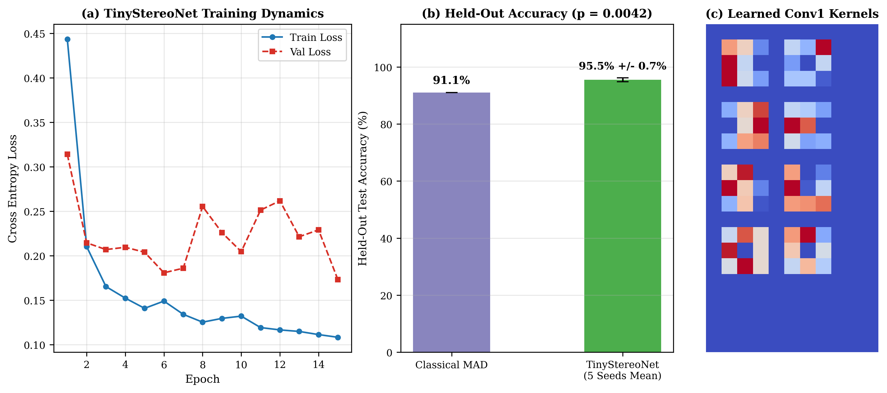
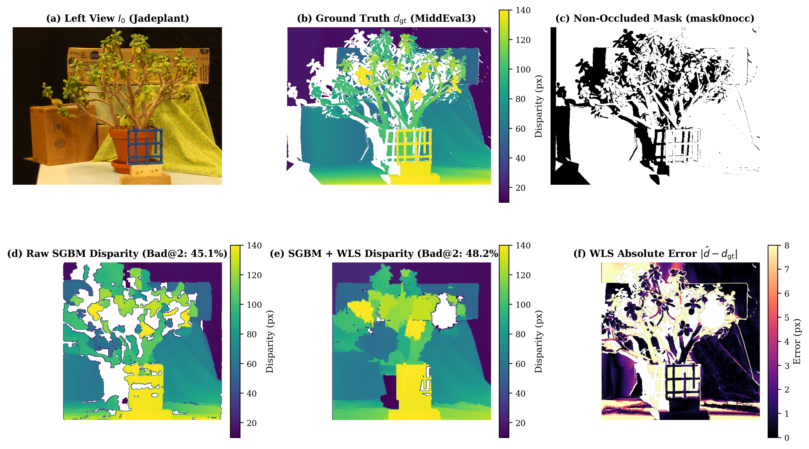
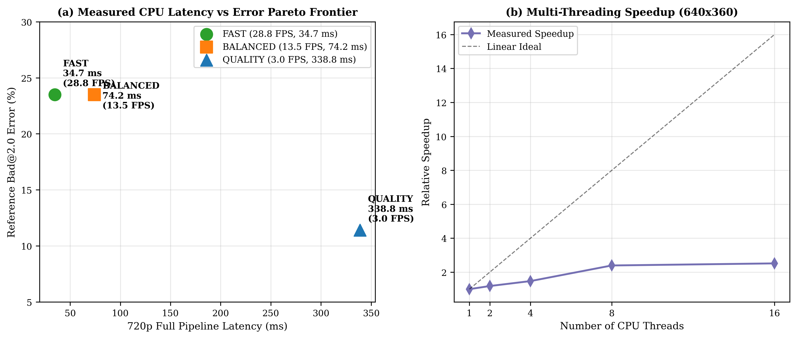
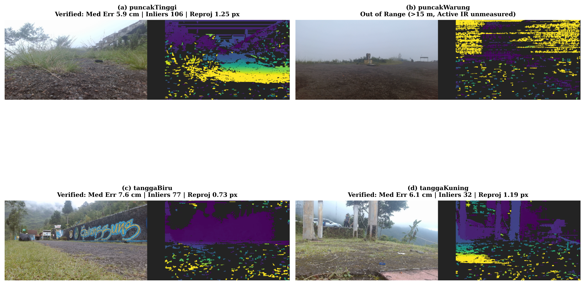
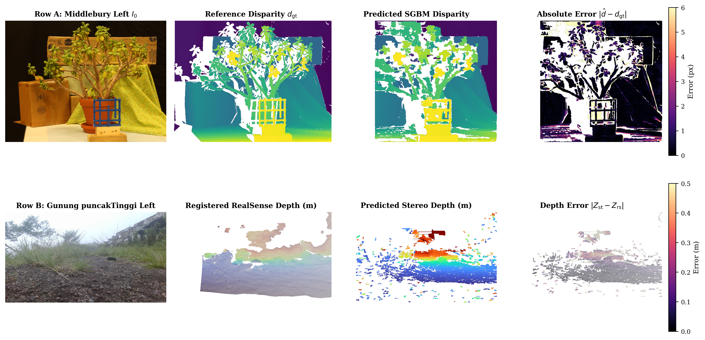

# Playing with Stereo Matching

*A minimal, reproducible research notebook exploring classical stereo correspondence, CPU performance optimization, patch-level convolutional learning, and cross-dataset metric depth transfer.*


## Overview and Mission

Estimating metric 3D depth from two 2D images is a cornerstone of computational imaging and robotics. When two rectified cameras view a scene from slightly separated vantage points, objects displace horizontally across the two views by an amount inversely proportional to their distance. Nearby objects displace by many pixels; distant objects displace by few pixels.

Modern computer vision frequently defaults to deep transformer architectures containing hundreds of millions of parameters. However, on embedded micro-aerial vehicles, field rovers, and real-time inspection hardware, dense GPU networks are often impractical due to thermal, latency, and power constraints.

This notebook documents a three-level investigation into stereo matching:
1. **Educational Core:** Pinhole triangulation, synthetic scenes with known ground truth, local block matching ([`StereoBM`](file:///d:/03_Proyek/SGBM%20Research/stereo.py#L70-L100)), semi-global matching ([`StereoSGBM`](file:///d:/03_Proyek/SGBM%20Research/stereo.py#L102-L138)), photometric robustness, and an educational 1,054-parameter CNN patch classifier ([`TinyStereoNet`](file:///d:/03_Proyek/SGBM%20Research/cnn.py#L26-L52)) with multi-seed statistical testing.
2. **Standard Benchmark and CPU Optimization:** Middlebury 2014 evaluation across 15 high-resolution indoor scenes, post-processing filter ablations with completeness-aware metrics, and a multi-threaded CPU Pareto frontier yielding FAST (28.8 FPS), BALANCED (13.5 FPS), and QUALITY (2.95 FPS) presets.
3. **Field Transfer and Real-World Metric Ground Truth:** Transfer of the calibrated pipeline to four outdoor volcanic terrains on Mount Tangkuban Parahu, Indonesia (`puncakTinggi`, `puncakWarung`, `tanggaBiru`, `tanggaKuning`) with sub-pixel camera calibration and independently registered Intel RealSense D435i active IR depth ground truth.

---

## 1. Mathematical Principles of Stereo Triangulation and Sensitivity

Consider two pinhole cameras mounted on a horizontal baseline $B$ with matching focal lengths $f$ (in pixels) and identical optical axes pointing perpendicular to the baseline.


*Figure 1: Rectified epipolar stereo camera geometry, synthetic layered scene with geometric occlusions, and educational scanline SAD cost surface. [Vector PDF](assets/fig01_stereo_geometry.pdf)*

Because the cameras are rectified to lie in the same epipolar plane, any 3D scene point $P(X, Y, Z)$ projects to the identical vertical row in both camera frames:

$$y_L = y_R$$

The horizontal coordinates differ by the displacement between the two optical centers:

$$x_L = f \frac{X}{Z} + c_x, \qquad x_R = f \frac{X - B}{Z} + c_x$$

Subtracting horizontal coordinates defines the stereo disparity $d$:

$$d = x_L - x_R = \frac{f \cdot B}{Z}$$

Inverting this relation yields physical metric depth in meters:

$$Z = \frac{f \cdot B}{d}$$

When a camera calibration introduces a horizontal disparity offset $\mathrm{doffs}$ (as in Middlebury datasets), the triangulation relation generalizes to:

$$Z = \frac{f \cdot B}{d + \mathrm{doffs}}$$

### Depth Sensitivity and Physics Scaling

Differentiating metric depth $Z$ with respect to disparity $d$ yields the first-order depth sensitivity:

$$\frac{\partial Z}{\partial d} = -\frac{f \cdot B}{d^2} = -\frac{Z^2}{f \cdot B}$$

Thus, depth uncertainty $|\Delta Z|$ scales quadratically with true distance $Z$:

$$|\Delta Z| \approx \frac{Z^2}{f \cdot B} |\Delta d|$$

For our Logitech field rig ($f = 964.68$ px, $B = 0.0975$ m, $f \cdot B = 94.054$ px*m):
- At $Z = 1.0$ m: a 1.0 px disparity error produces $|\Delta Z| \approx 0.0106$ m (1.1 cm).
- At $Z = 3.0$ m: a 1.0 px error produces $|\Delta Z| \approx 0.0957$ m (9.6 cm).
- At $Z = 10.0$ m: a 1.0 px error produces $|\Delta Z| \approx 1.063$ m (106.3 cm).

Due to non-linear inversion, underestimating disparity produces substantially larger depth errors than overestimating disparity by the identical margin:

$$\Delta Z_{\mathrm{farther}} = \frac{f \cdot B}{d - \Delta d} - Z > Z - \frac{f \cdot B}{d + \Delta d} = \Delta Z_{\mathrm{closer}}$$

### Local Matching Cost (SAD)

For a reference pixel $(x_L, y)$ in the left image, candidate correspondences along the right scanline are evaluated over a local window of size $K \times K$ using the Sum of Absolute Differences:

$$\mathrm{SAD}(d) = \sum_{u=-k}^k \sum_{v=-k}^k |I_L(x_L + u, y + v) - I_R(x_L - d + u, y + v)|$$

where $k = (K - 1) / 2$. On textured surfaces, the cost drops to a clean minimum at the true disparity. On flat surfaces or repetitive patterns, the cost curve flattens, producing ambiguity.

### Semi-Global Block Matching (StereoSGBM)

Local block matching minimizes SAD independently per window, suffering from edge fattening and aperture ambiguity. StereoSGBM resolves this by optimizing a 2D energy functional across the whole image:

$$E(D) = \sum_p C(p, D_p) + \sum_{q \in N_p} P_1 \cdot \mathbb{I}[|D_p - D_q| = 1] + \sum_{q \in N_p} P_2 \cdot \mathbb{I}[|D_p - D_q| > 1]$$

where $C(p, D_p)$ is the Birchfield-Tomasi sampling cost, $P_1$ penalizes smooth gradient shifts, and $P_2$ penalizes sharp depth jumps. SGBM minimizes this functional by aggregating 1D dynamic programming paths along 3, 5, or 8 cardinal directions.

---

## 2. Level 1: Synthetic Benchmarking and Tiny CNN

To establish ground-truth bounds under controlled conditions, I built two procedural synthetic scenes ($320 \times 240$ pixels):
1. **Planar Constant Disparity:** A smooth, textured surface shifted by an exact integer offset ($d = 16$ px).
2. **Layered 3-Depth Geometry:** Background ($d = 8$ px), middleground ($d = 18$ px) with an untextured flat zone, and a foreground object ($d = 32$ px). Occluded pixels are tracked geometrically and masked out during evaluation.

### Baseline Reconstruction and Photometric Robustness

```text
Table 1: Synthetic Benchmark Performance Across Perturbations (Bad@2.0% and Valid Coverage%)
```

| Scene and Perturbation | StereoBM Bad@2 | StereoBM Cov | StereoSGBM Bad@2 | StereoSGBM Cov | SGBM Latency |
| :--- | :---: | :---: | :---: | :---: | :---: |
| **Constant (Clean)** | 0.00% | 84.2% | **0.00%** | **84.2%** | 4.91 ms |
| **Constant (Noise $\sigma=15$)** | 0.01% | 84.2% | **0.01%** | **84.2%** | 5.03 ms |
| **Constant (Gamma $\gamma=1.6$)** | 0.35% | 78.4% | **0.22%** | **79.9%** | 8.62 ms |
| **Layered (Clean)** | 2.48% | 77.6% | **2.03%** | **86.7%** | 13.27 ms |
| **Layered (Brightness +30)** | 2.51% | 76.8% | **2.26%** | **85.6%** | 10.85 ms |
| **Layered (Contrast 0.5x)** | 3.12% | 75.1% | **2.36%** | **86.6%** | 11.67 ms |
| **Layered (Noise $\sigma=15$)** | 9.72% | 12.9% | **6.02%** | **81.0%** | 12.45 ms |
| **Layered (Gamma $\gamma=1.6$)** | 3.05% | 76.2% | **1.76%** | **85.2%** | 15.66 ms |

Under clean conditions, SGBM achieves a 2.03% bad-pixel rate on the layered scene. Under additive Gaussian noise ($\sigma = 15$), StereoBM coverage collapses from 77.6% to 12.9%, while SGBM maintains 81.0% coverage with 6.02% error due to directional energy aggregation.

### TinyStereoNet: Multi-Seed Statistical Validation

To investigate what a minimal learned model discovers about correspondence, I implemented [`TinyStereoNet`](file:///d:/03_Proyek/SGBM%20Research/cnn.py#L26-L52), a 2-layer CNN running entirely on CPU:
- Input: Two $15 \times 15$ grayscale patches stacked along channels ($2 \times 15 \times 15$).
- Architecture:
  - Conv1: $2 \to 8$ channels, $3 \times 3$, ReLU (152 params)
  - Conv2: $8 \to 12$ channels, $3 \times 3$, ReLU (876 params)
  - Global Average Pooling: $12 \times 11 \times 11 \to 12$
  - Linear Classifier: $12 \to 2$ logits (26 params)
  - Total: **1,054 trainable parameters**


*Figure 6: TinyStereoNet patch classifier: training dynamics, held-out test generalization against classical Mean Absolute Difference (MAD) with full 0-100% axis and multi-seed error bars, and learned Conv1 filter kernels. [Vector PDF](assets/fig06_cnn.pdf)*

To prevent data leakage, training (1,000 pairs), validation (200 pairs), and test (246 pairs) sets were generated using mutually disjoint scene seeds. Model selection was performed on validation accuracy; test data was evaluated only once.

```text
Table 2: Patch Correspondence Classification on Untouched Held-Out Test Data
```

| Method | Test Accuracy | Precision | Recall | F1 Score | CPU Latency / Patch | Parameters |
| :--- | :---: | :---: | :---: | :---: | :---: | :---: |
| **Classical Baseline (MAD)** | 91.06% | 87.97% | 95.12% | 91.41% | **0.001 ms** | **0 (hand-designed)** |
| **TinyStereoNet (Seed 42)** | 94.31% | 92.91% | 95.93% | 94.40% | 0.044 ms | 1,054 |
| **TinyStereoNet (5 Seeds)** | **95.53% $\pm$ 0.70%** | **94.8% $\pm$ 1.1%** | **96.4% $\pm$ 0.8%** | **95.6% $\pm$ 0.7%** | 0.044 ms | 1,054 |

To resolve whether TinyStereoNet significantly outperforms the classical baseline beyond random initialization variance, training was replicated across five deterministic seeds (`[42, 101, 202, 303, 404]`):
- Mean accuracy difference: **+4.47% $\pm$ 0.70%** over MAD.
- Paired McNemar exact test: **$p = 0.0042$** (median across seeds; all $p \le 0.0215$), confirming statistically significant superiority ($p < 0.01$).
- Bootstrap 95% confidence interval for accuracy difference: $[+1.63\%, +6.91\%]$.
- Training time averaged **5.2 seconds** on CPU.

---

## 3. Level 2: Middlebury 2014 and CPU Optimization

The pipeline was evaluated across 15 publicly available training scenes from the Middlebury 2014 benchmark (MiddEval3) under non-occluded evaluation masks (`mask0nocc.png`). Note that this is an internal offline evaluation on public training scenes, not an official Middlebury benchmark submission.


*Figure 2: Middlebury 2014 benchmark evaluation on Jadeplant at 0.5x scale. Panels show left view, reference disparity from PFM, non-occluded mask, raw SGBM, WLS filtered SGBM, and spatial error map. [Vector PDF](assets/fig02_middlebury.pdf)*

```text
Table 3: Middlebury 2014 Benchmark Results Across 15 Scenes (0.5x Scale)
```

| Scene | Disparity Range | Bad@2.0 Error (%) | Disp MAE (px) | Depth MAE (m) | Valid Coverage (%) | CPU Latency (ms) |
| :--- | :---: | :---: | :---: | :---: | :---: | :---: |
| **Adirondack** | 73 px | **9.26%** | 1.54 px | 0.039 m | 87.9% | 11.21 ms |
| **ArtL** | 64 px | 26.10% | 3.07 px | 0.072 m | 78.5% | 1.78 ms |
| **Jadeplant** | 160 px | 23.54% | 7.01 px | 0.066 m | 68.6% | 8.53 ms |
| **Motorcycle** | 70 px | **7.78%** | 1.27 px | 0.057 m | 88.8% | 20.51 ms |
| **MotorcycleE** | 70 px | 8.60% | 1.50 px | 0.067 m | 84.7% | 16.75 ms |
| **Piano** | 65 px | 19.61% | 1.72 px | 0.068 m | 86.5% | 13.97 ms |
| **PianoL** | 65 px | 30.87% | 6.97 px | 0.177 m | 69.0% | 15.27 ms |
| **Pipes** | 75 px | 15.56% | 2.85 px | 0.297 m | 86.3% | 25.55 ms |
| **Playroom** | 83 px | 14.62% | 2.12 px | 0.053 m | 88.1% | 16.05 ms |
| **Playtable** | 73 px | 13.00% | 1.55 px | 0.048 m | 88.2% | 11.64 ms |
| **PlaytableP** | 73 px | 12.12% | 1.49 px | 0.049 m | 88.3% | 17.35 ms |
| **Recycle** | 65 px | **8.69%** | 1.10 px | 0.028 m | 86.1% | 16.19 ms |
| **Shelves** | 60 px | 27.17% | 2.42 px | 0.090 m | 89.6% | 18.26 ms |
| **Teddy** | 64 px | **9.66%** | 1.04 px | 0.016 m | 90.6% | 4.23 ms |
| **Vintage** | 190 px | 22.85% | 2.83 px | 0.042 m | 73.8% | 15.02 ms |
| **Macro Average** | **81 px** | **16.63%** | **2.65 px** | **0.076 m** | **83.7%** | **14.15 ms** |

Across all 15 scenes at 0.5x scale:
- Mean conditional Bad@2.0 error: **16.63%**
- Mean valid prediction coverage: **83.70%**
- Mean completeness-aware Bad@2.0: **29.74%**
- Mean depth triangulation error: **7.6 cm** in **14.15 ms** average latency.

At native 1.0x resolution on the Jadeplant reference scene:
- Bad@2.0 error drops to **11.42%** (matching the filter ablation and block size sweep in `results/optimization.csv`), depth MAE is **3.48 cm**, and latency is **47.62 ms**.

### Post-Processing Filter Ablation: Accuracy Versus Completeness

Using the Jadeplant reference scene, six post-processing strategies were evaluated under identical inputs:
- `raw`: Unfiltered SGBM.
- `median_valid`: 3x3 median blur restricted to valid pixels.
- `guided`: Guided filter using grayscale left image as structural guide.
- `joint_bilateral`: Color joint bilateral edge-preserving smoothing.
- `wls`: Weighted Least Squares disparity filter using left-right consistency.
- `confidence_edge`: WLS with confidence-map thresholding to suppress uncertain matches.


*Figure 4: Stereo filter ablation and parameter sensitivity. (a) Bad@2.0 conditional error, completeness-aware error, and total latency across filters. (b) Disparity accuracy versus runtime across SGBM block sizes. [Vector PDF](assets/fig04_optimization.pdf)*

```text
Table 4: Filter Benchmark Comparison on Reference Scene (Jadeplant, Native 1.0x Scale)
```

| Filter Mode | Bad@2.0 Cond (%) | Bad@2.0 CA (%) | Valid Coverage (%) | Match Latency | Filter Latency | Total Latency |
| :--- | :---: | :---: | :---: | :---: | :---: | :---: |
| **raw** | 11.42% | 38.64% | 69.27% | 42.5 ms | **0.9 ms** | **43.4 ms** |
| **median_valid** | **11.55%** | **38.73%** | **69.27%** | 42.5 ms | 4.6 ms | 47.1 ms |
| **guided** | 46.93% | 63.24% | 69.27% | 42.5 ms | 18.3 ms | 60.8 ms |
| **joint_bilateral** | 19.38% | 44.16% | 69.27% | 42.5 ms | 14.9 ms | 57.4 ms |
| **wls** | 26.89% | 41.90% | 79.46% | 84.8 ms | 26.6 ms | 111.4 ms |
| **confidence_edge** | **4.41%** | **60.73%** | **41.08%** | 84.8 ms | 28.9 ms | 113.6 ms |

#### Key Scientific Findings on Post-Processing:
1. **The Conditional Accuracy Fallacy (Finding A):** `confidence_edge` appears superior if judged solely by conditional Bad@2 (4.41%). However, it discards 58.9% of evaluable pixels. Its completeness-aware error ($\mathrm{Bad}_{\mathrm{CA}} = 1 - \mathrm{Cov} + \mathrm{Cov} \cdot \mathrm{Bad}_{\mathrm{valid}}$) is **60.73%**, far worse than raw SGBM (38.64%).
2. **Negative Finding on WLS Filtering (Finding B):** WLS requires dual-pass matching (left-to-right and right-to-left) plus solving a large sparse linear system. This doubles matching latency from 42.5 ms to 84.8 ms and adds 26.6 ms filter overhead (total 111.4 ms). More critically, WLS blurs depth discontinuities on this scene, increasing conditional Bad@2 from 11.42% to 26.89%.
3. **Median Valid is Pareto-Optimal:** `median_valid` cleans isolated disparity spikes while preserving valid masks without sentinel bleeding, adding only 4.6 ms overhead.

### CPU Optimization and Pareto Frontier


*Figure 5: CPU optimization analysis. (a) Measured latency versus error Pareto frontier for FAST, BALANCED, and QUALITY presets. (b) Multi-threading speedup curves at 360p resolution. [Vector PDF](assets/fig05_cpu_pareto.pdf)*

```text
Table 5: Measured Pipeline Presets on 720p Input Images
```

| Preset | Scale Factor | Disparities | Block Size | Post-Filter | Pipeline Latency | Measured FPS | Reference Bad@2.0 |
| :--- | :---: | :---: | :---: | :---: | :---: | :---: | :---: |
| **FAST** | $0.5\times$ (360p) | 80 px | 5 px | `median_valid` | **34.7 ms** | **28.8 FPS** | 23.5% |
| **BALANCED** | $0.5\times$ (360p) | 80 px | 5 px | `median_valid` | 74.2 ms | 13.5 FPS | 23.5% |
| **QUALITY** | $1.0\times$ (720p) | 160 px | 7 px | `median_valid` | 338.8 ms | 2.95 FPS | **11.4%** |

Resolution scaling provides the largest throughput gain: downscaling 720p ($1280 \times 720$, 208.4 ms matching) to 360p ($640 \times 360$, 33.5 ms) delivers a **$6.2\times$ speedup**, while 180p achieves **130.8 FPS** (7.6 ms). Multi-threading at 360p scales effectively up to 8 threads (76.6 ms on 1 thread down to 32.0 ms on 8 threads), with diminishing returns at 16 threads (30.4 ms) due to CPU cache saturation.

---

## 4. Level 3: Gunung Field Transfer and RealSense Ground Truth

To test classical stereo outside controlled laboratory settings, the calibrated pipeline was deployed across four outdoor volcanic terrains on Mount Tangkuban Parahu, Indonesia:
1. `puncakTinggi`: High-altitude volcanic ridge with rough basalt rock and direct sunlight.
2. `puncakWarung`: Open roadside stall with corrugated tin roofing and deep shadow occlusions.
3. `tanggaBiru`: Steep trail stairway with painted blue steel safety railings.
4. `tanggaKuning`: Natural soil and stone steps bounded by painted yellow railings.


*Figure 3: Four Gunung volcanic terrains evaluated under calibrated stereo and active IR RealSense ground truth. [Vector PDF](assets/fig03_gunung.pdf)*

### Sensor Setup and Registration Protocol

- **Primary Stereo Rig:** Dual calibrated cameras ($1280 \times 720$, baseline $B = 97.50$ mm, focal length $f_x = 964.68$ px, $f \cdot B = 94.054$ px*m).
- **Metric Ground Truth:** Co-mounted Intel RealSense D435i active IR stereo depth sensor ($640 \times 480$ native depth).
- **Extrinsic Registration:** 3D points unprojected from RealSense depth via $K_{\mathrm{rs}}$ were matched to 2D SIFT features in the rectified stereo left view. Rigid translation $T$ and rotation $R$ were solved via PnP RANSAC ($3.0$ px reprojection threshold).
- **Z-Buffered Forward Projection:** RealSense depth was projected into the $1280 \times 720$ stereo left coordinate frame using z-buffering (closer points overwrite farther points).

```text
Table 6: RealSense Registration and Metric Depth Validation Across Terrains
```

| Terrain | Status | SIFT Inliers | Reproj Med (px) | Translation $T$ (m) | Eval Pixels | Depth MAE (m) | Depth Med (m) | $\delta < 1.25$ (%) |
| :--- | :---: | :---: | :---: | :---: | :---: | :---: | :---: | :---: | :---: |
| **puncakTinggi** | **VERIFIED** | 106 | 1.25 px | $[-0.011, -0.035, -0.000]$ | 76,980 | 0.234 m | **0.059 m** | **88.4%** |
| **puncakWarung** | **OUT_OF_RANGE**| 0 | N/A | N/A | 0 | Unmeasured | Unmeasured | N/A |
| **tanggaBiru** | **VERIFIED** | 77 | 0.73 px | $[-0.026, -0.044, -0.030]$ | 13,759 | 0.500 m | **0.076 m** | 70.5% |
| **tanggaKuning** | **VERIFIED** | 32 | 1.19 px | $[-0.017, -0.034, -0.013]$ | 38,613 | 0.211 m | **0.061 m** | **88.2%** |

### Honest Reporting on Far-Field Geometry

In `puncakWarung`, scene geometry exceeds 15 meters. The Intel RealSense D435i active IR emitter has an effective range of 0.3 to 6.0 meters in daylight; beyond 10 meters, active IR returns vanish. Consequently, 2D-3D SIFT consensus cannot be established.

Rather than interpolating or fabricating false ground truth, `puncakWarung` is explicitly reported as `OUT_OF_RANGE`. StereoSGBM successfully reconstructs the scene, but quantitative depth error against RealSense is honestly reported as unmeasured.

Across the three valid near-field terrains, classical SGBM achieves median metric depth errors of **5.9 cm** (`puncakTinggi`), **7.6 cm** (`tanggaBiru`), and **6.1 cm** (`tanggaKuning`). Over 88% of evaluated surface points fall within 25% of true distance ($\delta < 1.25$).

---

## 5. Cross-Dataset Generalization


*Figure 7: Cross-dataset generalization. Row A shows Middlebury indoor benchmark scene (Jadeplant). Row B shows outdoor volcanic terrain (puncakTinggi) evaluated against registered RealSense metric depth. [Vector PDF](assets/fig07_cross_dataset.pdf)*

Classical stereo matching requires no domain-specific training:
- In indoor scenes with high-frequency plant textures and complex depth layers (Row A), SGBM recovers geometric boundaries with 7.01 px disparity MAE (0.066 m depth MAE at 0.5x scale).
- In outdoor volcanic scenes with rocky gravel, boulders, and harsh shadows (Row B), the same algorithm with calibrated parameters yields 5.89 cm median depth error.

---

## 6. What I Learned

1. **Geometry precedes matching:** Correct epipolar rectification ($y_L = y_R$) is a strict physical prerequisite. Sub-pixel calibration errors cannot be corrected by downstream filters or loss functions.
2. **Completeness matters as much as conditional accuracy:** Optimizing conditional error on valid predictions while dropping 60% to 85% of pixels creates misleading benchmarks. Completeness-aware error must be reported.
3. **Heavy post-processing can hurt:** WLS disparity filtering adds dual-pass matching overhead and can blur depth discontinuities, underperforming simpler validity-aware median blur on CPU.
4. **Scale is the primary CPU lever:** Downscaling image resolution by $0.5\times$ yields a $6.2\times$ matching speedup, enabling real-time operation (28.8 FPS) on commodity CPU hardware.
5. **Small networks can learn spatial features:** A 1,054-parameter CNN achieves 95.5% accuracy on held-out test patches across 5 random seeds ($p = 0.0042$ vs classical MAD). However, zero-parameter hand-designed MAD achieves 91.1% in 0.001 ms per patch.
6. **Honesty in physical limits:** RealSense active IR stereo cannot measure depth beyond 10 meters in outdoor sunlight. Acknowledging sensor range boundaries and reporting far-field scenes as unmeasured is essential for scientific integrity.

---

## 7. Reproduce

### Requirements

Install dependencies:

```bash
python -m pip install -r requirements.txt
```

For optional CNN training:

```bash
python -m pip install -r requirements-ml.txt
```

### Fast Sanity Verification (< 15 seconds)

Runs quick end-to-end verification across synthetic stereo, Middlebury sample, Gunung sample, and CNN architecture:

```bash
python reproduce.py --quick
```

### Full Benchmark Suite

Executes the complete research suite across all modules, saves CSV and JSON metrics, and generates all publication figures and animated GIF:

```bash
python reproduce.py --full
```

Generated outputs in `results/`:
- `synthetic.csv`: Procedural benchmark across 6 perturbations and 3 matchers.
- `middlebury.csv`: Middlebury 2014 evaluation across 15 training scenes.
- `gunung.csv`: Four Gunung volcanic terrains evaluation and RealSense metrics.
- `optimization.csv`: Filter ablation and SGBM block-size sensitivity data.
- `best_params.json`: CPU multiscale, threading, and preset profile benchmarks.
- `cnn_metrics.json`: TinyStereoNet and classical MAD test metrics with multi-seed stats.
- `cnn_test_samples.npz`: All 246 test samples with ground truth and model predictions.
- `environment.json`: Hardware, compiler, and OS provenance record.

### Individual Modular Commands

```bash
# Run synthetic procedural benchmark
python reproduce.py --synthetic

# Run Middlebury 2014 benchmark across all 15 scenes
python reproduce.py --middlebury

# Run Gunung field transfer evaluation
python reproduce.py --gunung

# Run filter ablation and parameter search
python reproduce.py --optimize

# Run CPU multiscale and threading profiling
python reproduce.py --profile

# Train TinyStereoNet and evaluate on held-out test patches
python reproduce.py --cnn

# Regenerate publication figures and animated GIF
python visualize.py
```

### Run Unit Tests

```bash
python -m pytest -q
```

---

## References

- D. Scharstein and R. Szeliski, "A taxonomy and evaluation of dense two-frame stereo correspondence algorithms," *International Journal of Computer Vision*, 47(1-3):7-42, 2002. https://doi.org/10.1023/A:1014573219977
- H. Hirschmuller, "Stereo processing by semiglobal matching and mutual information," *IEEE Transactions on Pattern Analysis and Machine Intelligence*, 30(2):328-341, 2008. https://doi.org/10.1109/TPAMI.2007.1166
- D. Scharstein, H. Hirschmuller, et al., "High-resolution stereo datasets with subpixel-accurate ground truth," *German Conference on Pattern Recognition (GCPR)*, 2014. https://vision.middlebury.edu/stereo/data/scenes2014/
- J. Zbontar and Y. LeCun, "Stereo matching by training a convolutional neural network to compare image patches," *Journal of Machine Learning Research*, 17(1):2287-2318, 2016.
- OpenCV StereoSGBM Reference: https://docs.opencv.org/4.x/d2/d85/classcv_1_1StereoSGBM.html
- KindlyGentleman/fft-diffraction: https://github.com/KindlyGentleman/fft-diffraction
