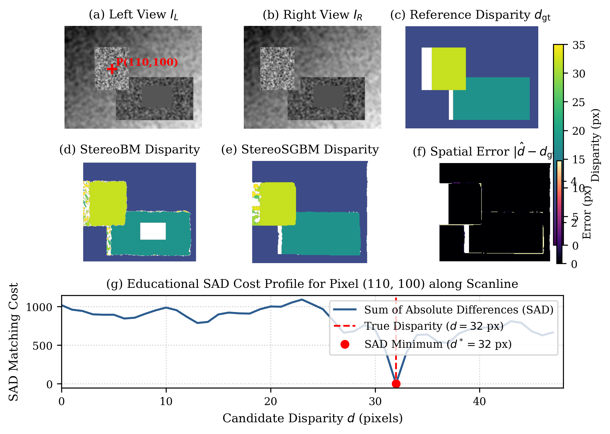
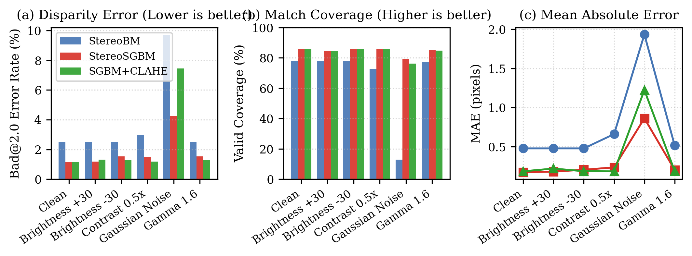
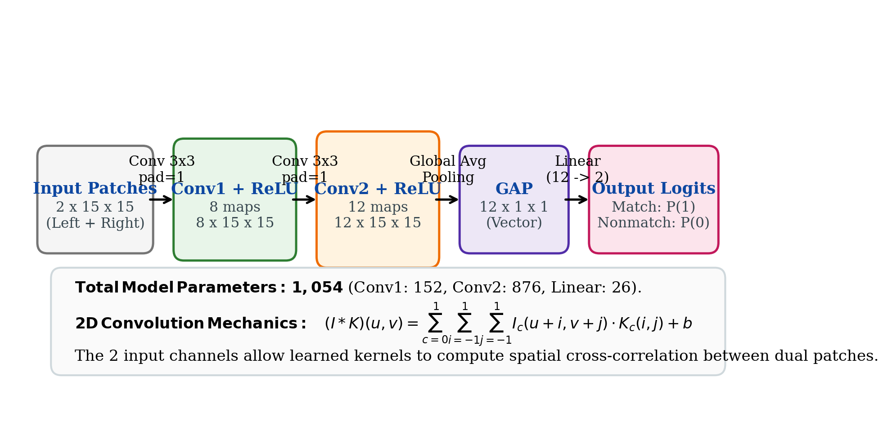
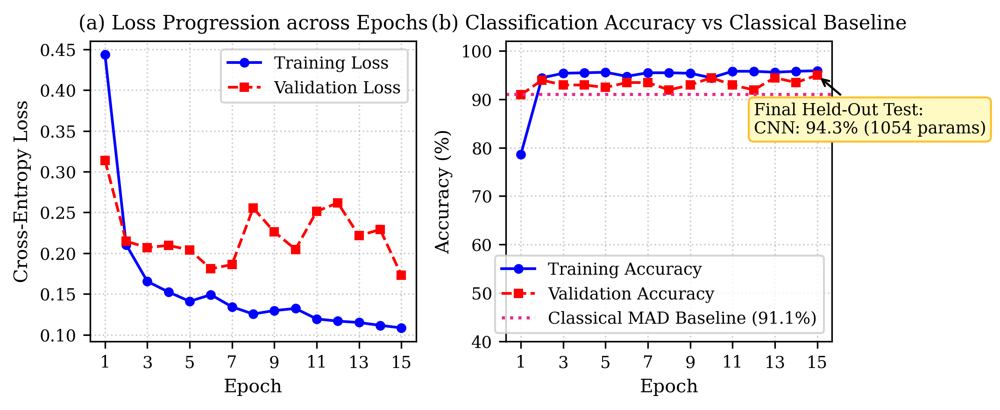
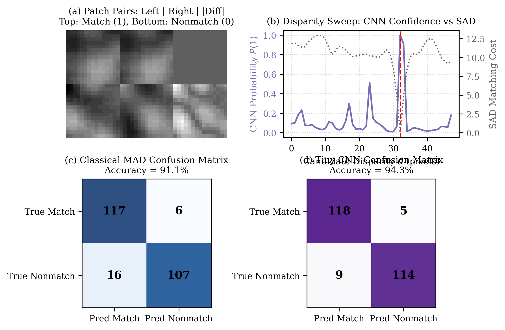

# Playing with Stereo Matching

*A small experiment exploring how stereo cameras estimate depth, how classical matching algorithms work, and what a tiny CNN can learn from image patches.*


## What I wanted to understand

Estimating 3D depth from two 2D camera images is one of the foundational problems in computer vision. When two parallel cameras view the same three-dimensional scene from slightly different horizontal vantage points, objects shift horizontally in each image plane depending on how far they are from the camera. Nearby objects shift by a large distance; distant objects shift by a small distance.

Modern depth estimation is dominated by large neural networks trained on millions of parameters. However, the fundamental physical problem has not changed: finding which pixel in the right camera corresponds to a given pixel in the left camera.

I wanted to build a minimal, visual notebook to answer four specific questions:
1. What mathematical relationship turns horizontal pixel shifts into metric depth?
2. How do classical block matching (StereoBM) and semi-global matching (StereoSGBM) work, and where do they fail?
3. How vulnerable are classical stereo matchers to brightness, contrast, noise, and non-linear sensor response?
4. What can a tiny convolutional neural network (CNN) with roughly 1,000 parameters learn about image patches, and does it actually outperform a simple hand-designed difference rule?

## How two images become depth

Consider two idealized pinhole cameras mounted on a shared horizontal rail. Both cameras share the same focal length $f$ (measured in pixels) and identical optical axes pointing perpendicular to the camera baseline $B$ (the physical distance between the two optical centers $O_L$ and $O_R$).


*Figure 1: Rectified pinhole stereo geometry. A 3D point $P(X, Y, Z)$ projects to pixel coordinates $x_L$ and $x_R$ on parallel image planes separated by baseline $B$. [Vector PDF](assets/fig01_stereo_geometry.pdf)*

Because the cameras are horizontally aligned and free of relative tilt (epipolar rectification), any 3D point $P(X, Y, Z)$ projects to the exact same vertical scanline in both views:

$$y_L = y_R$$

The horizontal positions, however, differ:

$$x_L = f \frac{X}{Z} + c_x, \qquad x_R = f \frac{X - B}{Z} + c_x$$

Subtracting the two horizontal coordinates yields the stereo disparity $d$:

$$d = x_L - x_R = \frac{f \cdot B}{Z}$$

Disparity is measured in pixels and varies inversely with depth. Inverting this relation yields the distance to the point in meters:

$$Z = \frac{f \cdot B}{d}$$

When calibrated stereo cameras produce rectified images, the 2D search for corresponding points collapses into a 1D search strictly along horizontal scanlines.

## First, a hand-designed matching cost

Before running large solvers, consider how a single pixel finds its match. For a reference pixel $(x_L, y)$ in the left image, its true physical counterpart must reside at $(x_L - d, y)$ in the right image for some unknown non-negative disparity $d \ge 0$.

Comparing individual pixels is sensitive to sensor noise. Instead, we extract a small $K \times K$ square window around $(x_L, y)$ and slide a candidate window along the same scanline in the right image. At each candidate disparity $d$, we measure similarity using the Sum of Absolute Differences (SAD):

$$\mathrm{SAD}(d) = \sum_{u=-k}^k \sum_{v=-k}^k |I_L(x_L + u, y + v) - I_R(x_L - d + u, y + v)|$$

where $k = (K - 1) / 2$. The candidate disparity that produces the lowest SAD cost is chosen as the estimated disparity:

$$d^* = \arg\min_d \mathrm{SAD}(d)$$

On a textured surface, the SAD curve drops to a sharp minimum at the true physical disparity. However, in regions lacking texture (such as a plain wall or untextured surface), the SAD curve becomes flat and ambiguous: multiple candidate disparities yield almost identical costs.

## From block matching to semi-global matching

Local block matching (OpenCV `StereoBM`) computes window-based similarity independently for every pixel. While fast, it suffers from two major limitations:
1. **Aperture ambiguity:** In untextured or repeating regions, local windows lack distinct features.
2. **Edge fattening:** Fixed square windows straddling depth boundaries mix foreground and background disparities, blurring object contours.

Semi-Global Block Matching (StereoSGBM) addresses this by formulating stereo as an energy minimization problem over the entire image:

$$E(D) = \sum_p C(p, D_p) + \sum_{q \in N_p} P_1 \cdot \mathbb{I}[|D_p - D_q| = 1] + \sum_{q \in N_p} P_2 \cdot \mathbb{I}[|D_p - D_q| > 1]$$

where $C(p, D_p)$ is the matching cost (based on Birchfield-Tomasi pixel sampling), $P_1$ penalizes small disparity steps (slanted surfaces), and $P_2$ penalizes large disparity jumps (depth discontinuities). StereoSGBM approximates 2D global MRF optimization by aggregating costs along 1D paths (typically 3, 5, or 8 directional paths) using dynamic programming.


*Figure 2: Classical stereo matching evaluated on a 3-layer synthetic scene with occlusions and a low-texture patch. Panels (a-b) show left and right views. Panel (c) shows reference disparity with occlusions excluded. Panels (d-e) show StereoBM and StereoSGBM reconstructions. Panel (f) plots spatial error. Panel (g) shows the educational SAD cost curve for foreground pixel P(110, 100). [Vector PDF](assets/fig02_classical_matching.pdf)*

To evaluate both algorithms objectively, I constructed a 3-layer synthetic test scene ($320 \times 240$ pixels) containing:
- A far background ($d = 8$ px) with smooth gradient texture
- A middle-ground surface ($d = 18$ px) with a flat untextured patch
- A near foreground rectangular object ($d = 32$ px)
- Exact geometric occlusion tracking (pixels occluded in the right view are marked invalid)

| Algorithm | Bad@2.0 Error (%) | Bad@1.0 Error (%) | MAE (px) | Coverage (%) | CPU Latency (ms) |
| :--- | :---: | :---: | :---: | :---: | :---: |
| **StereoBM** | 2.48% | 2.49% | 0.477 px | 77.6% | **3.82 ms** |
| **StereoSGBM** | **1.15%** | **1.20%** | **0.172 px** | **86.0%** | 5.59 ms |
| **StereoSGBM + CLAHE** | 1.16% | 1.21% | 0.184 px | **86.1%** | 5.75 ms |

StereoSGBM achieves less than half the bad-pixel rate of StereoBM (1.15% vs 2.48%) while maintaining higher valid coverage (86.0% vs 77.6%). Its path-based smoothness penalty prevents arbitrary disparity assignments across the untextured patch in the middle ground, whereas StereoBM rejects those pixels as ambiguous.

## When lighting changes

In real-world deployment, dual cameras rarely experience identical illumination. Lenses have vignette variations, sensors drift in analog gain, and sunlight creates dynamic shadows.

I evaluated StereoBM, StereoSGBM, and StereoSGBM with Contrast Limited Adaptive Histogram Equalization (CLAHE) under five controlled perturbations applied to the right camera image while holding scene geometry constant:
1. **Clean baseline:** No photometric distortion.
2. **Brightness imbalance:** Additive shift of $\pm 30$ intensity levels.
3. **Low contrast:** Multiplicative scaling of contrast down to $0.5\times$.
4. **Gaussian noise:** Zero-mean noise with standard deviation $\sigma = 15$.
5. **Non-linear gamma:** Sensor response curve with $\gamma = 1.6$.


*Figure 3: Photometric robustness comparison on the layered scene. (a) Bad@2.0 error rate (lower is better). (b) Valid prediction coverage (higher is better). (c) Disparity Mean Absolute Error in pixels. [Vector PDF](assets/fig03_photometric_robustness.pdf)*

Key findings from the perturbation study:
- **Noise breaks window matching:** Under additive Gaussian noise ($\sigma = 15$), StereoBM coverage collapses from 77.6% down to 12.91%, with error rising to 9.72%. StereoSGBM retains 79.53% coverage with 4.23% error due to path aggregation.
- **When CLAHE helps:** Under low contrast ($0.5\times$), CLAHE pre-equalization boosts contrast, dropping StereoSGBM error from 1.49% to 1.18% and raising coverage to 86.15%.
- **When CLAHE hurts:** Under Gaussian noise, CLAHE amplifies high-frequency noise grains, worsening StereoSGBM error from 4.23% to 7.45%. Normalization filters must not be applied blindly to every input condition.

## What is a convolutional neural network?

Before training a neural network on patches, it is helpful to clarify what a CNN actually computes. A convolutional neural network for image patches is not an impenetrable black box: it is a sequence of sliding linear dot products followed by elementwise non-linear thresholding.


*Figure 4: Educational architecture of TinyStereoNet. Two $15 \times 15$ grayscale patches form a 2-channel input tensor. Two small $3 \times 3$ convolution layers extract features, Global Average Pooling condenses spatial dimensions, and a 2-unit linear layer outputs match probabilities. [Vector PDF](assets/fig04_cnn_architecture.pdf)*

Core components of the implemented network:
- **Convolution:** A small 2D array of learned numbers (a kernel) slides across the input image. At each spatial position, it computes the elementwise product with the underlying image patch and sums the results into a single number.
- **Kernel:** The set of learned weight coefficients. PyTorch implements this operation as 2D cross-correlation by convention.
- **Feature Map:** The 2D array produced by sliding a kernel across the input.
- **ReLU (Rectified Linear Unit):** An activation function defined as $f(x) = \max(0, x)$. It introduces non-linearity, allowing the network to learn decision boundaries that linear combinations cannot represent.
- **Global Average Pooling (GAP):** A spatial reduction operation that computes the mean of every feature map, collapsing an $H \times W$ spatial map into a single scalar value per channel.
- **Logits:** The unnormalized raw scores $[z_0, z_1]$ produced by the final linear layer.
- **Loss:** A mathematical penalty comparing predicted probabilities against ground-truth labels. We use Cross-Entropy Loss: $\mathcal{L} = -\log P(y)$.
- **Backpropagation:** Computing partial derivatives of the loss with respect to every weight using the chain rule, which Adam then uses to update parameters.
- **Epoch:** One complete training pass through the entire training dataset.
- **Generalization:** The model ability to accurately classify unseen patch pairs sampled from novel random seeds.

The architecture implemented in `cnn.py` has exactly **1,054 parameters**:
- Conv1: $2 \text{ inputs} \times 8 \text{ filters} \times (3 \times 3) + 8 \text{ biases} = 152$ parameters
- Conv2: $8 \text{ inputs} \times 12 \text{ filters} \times (3 \times 3) + 12 \text{ biases} = 876$ parameters
- Linear: $12 \text{ inputs} \times 2 \text{ outputs} + 2 \text{ biases} = 26$ parameters
- Total: $152 + 876 + 26 = 1,054$ parameters

## Can a tiny CNN learn correspondence?

To test what a 1,054-parameter network can learn, I set up a binary patch classification experiment:
- **Input:** Two $15 \times 15$ grayscale patches stacked along the channel axis (shape: $2 \times 15 \times 15$).
- **Positive pairs (Label 1):** A left patch and the geometrically true matching right patch at $(x_L - d, y)$.
- **Negative pairs (Label 0):** A left patch paired with an incorrect candidate patch ($|d' - d| \ge 2$ or a different location), sampled under identical noise and brightness statistics.
- **Data partition:** Datasets are partitioned strictly by scene random seed to eliminate data leakage:
  - Training: Seeds 100 to 109 (968 balanced patch pairs)
  - Validation: Seeds 200 to 203 (198 balanced patch pairs)
  - Held-out test: Seeds 300 to 304 (246 balanced patch pairs)


*Figure 5: Training progression of TinyStereoNet over 15 epochs on CPU. (a) Cross-entropy loss curve. (b) Training and validation accuracy relative to the classical MAD baseline. Final held-out test accuracy is evaluated strictly after model selection. [Vector PDF](assets/fig05_cnn_learning.pdf)*

Training on a standard CPU takes **2.42 seconds** for 15 epochs (roughly 161 ms per epoch). Validation accuracy climbs steadily from 50.0% (random guess) up to 94.9%, confirming that two tiny convolution layers can extract discriminative cross-channel spatial relationships.

## Does learning beat a simple matching rule?

To place the CNN performance in context, I implemented a hand-designed baseline: Mean Absolute Difference (MAD). It computes the mean pixel difference across both normalized patches:

$$\mathrm{MAD}(P_L, P_R) = \frac{1}{15 \times 15} \sum_{u=1}^{15} \sum_{v=1}^{15} |P_L(u, v) - P_R(u, v)|$$

A decision threshold $\tau$ was selected using validation data only ($\tau^* = 0.364$). Any pair with $\mathrm{MAD} < \tau^*$ is classified as a match (1), and nonmatch (0) otherwise. Both the classical baseline and TinyStereoNet were then evaluated on the untouched held-out test set (246 samples).


*Figure 6: Classical MAD baseline versus Tiny CNN on held-out test data. (a) Positive and negative test patch pairs. (b) Disparity scan along an epipolar line comparing CNN match probability with SAD cost. (c-d) Test confusion matrices for classical MAD and TinyStereoNet. [Vector PDF](assets/fig06_classical_vs_cnn.pdf)*

| Method | Test Accuracy | Precision | Recall | F1 Score | CPU Latency / Patch | Trainable Params |
| :--- | :---: | :---: | :---: | :---: | :---: | :---: |
| **Classical MAD** | 91.1% | 88.0% | 95.1% | 91.4% | **0.001 ms** | **0 (hand-designed)** |
| **Tiny CNN (Learned)** | **94.3%** | **92.9%** | **95.9%** | **94.4%** | 0.023 ms | 1,054 |

The tiny CNN improves accuracy over the classical baseline by 3.2 percentage points (94.3% vs 91.1%), reducing false positives from 16 down to 9 on the test set.

However, notice the computational cost: the classical difference rule requires zero training, zero learned weights, and executes more than 20 times faster on CPU. For simple patch correspondence tasks under clean conditions, a hand-designed similarity metric is remarkably capable. Machine learning adds value when geometric deformations, subtle subpixel misalignments, or complex photometric non-linearities must be learned from data.

## What I learned

1. **Geometry dictates performance first:** Correct horizontal epipolar alignment ($y_L = y_R$) is a strict precondition for stereo matching. No amount of parameter tuning or neural capacity can compensate for unrectified vertical camera misalignment.
2. **Semi-global aggregation resolves local ambiguities:** StereoBM fails in untextured regions because local square windows lack distinctive gradients. StereoSGBM path-based energy minimization enforces smoothness across flat areas without blurring sharp object boundaries.
3. **Contrast filters are double-edged swords:** CLAHE improves stereo matching under low contrast, but amplifies sensor noise under high-noise conditions. Filtering decisions must be matched to sensor characteristics.
4. **Missing predictions matter:** Completeness-aware metrics ensure matchers cannot game accuracy scores by rejecting difficult border or low-texture pixels.
5. **Small networks can learn correspondence:** A 2-layer CNN with only 1,054 parameters achieves 94.3% classification accuracy on held-out patches in 2.4 seconds of CPU training, but a hand-designed MAD baseline achieves 91.1% with zero training time.

## Reproduce

### Requirements

```bash
python -m pip install -r requirements.txt
```

For optional CNN training:

```bash
python -m pip install -r requirements-ml.txt
```

### Fast Verification (< 1 second)

Runs sanity verification on constant and layered synthetic scenes:

```bash
python reproduce.py --quick
```

### Full Benchmark Experiment

Executes the complete classical stereo benchmark across scenes, matchers, and perturbations:

```bash
python reproduce.py --full
```

Outputs:
- `results/metrics.csv`
- `results/sample_disparities.npz`
- `results/sad_profile.json`
- `results/environment.json`

### Train and Evaluate Tiny CNN

Trains TinyStereoNet on CPU and evaluates against the classical baseline on held-out test data:

```bash
python cnn.py --epochs 15 --threads 2
```

Outputs:
- `results/cnn_history.csv`
- `results/cnn_metrics.json`
- `results/tiny_cnn.pt`

### Regenerate Visualizations

Generates all publication figures and the hero animated GIF:

```bash
python visualize.py
```

Outputs:
- `assets/fig01_stereo_geometry.png` and `.pdf`
- `assets/fig02_classical_matching.png` and `.pdf`
- `assets/fig03_photometric_robustness.png` and `.pdf`
- `assets/fig04_cnn_architecture.png` and `.pdf`
- `assets/fig05_cnn_learning.png` and `.pdf`
- `assets/fig06_classical_vs_cnn.png` and `.pdf`
- `assets/stereo_loop.gif`

### Run Unit Tests

```bash
python -m pytest -q
```

### Optional External Datasets

Evaluate Middlebury 2014 or calibrated outdoor transfer when datasets are available:

```bash
python reproduce.py --middlebury path/to/MiddEval3/trainingQ
python reproduce.py --gunung path/to/gunung --calib path/to/stereo_params.npz
```

## References

- D. Scharstein and R. Szeliski, "A taxonomy and evaluation of dense two-frame stereo correspondence algorithms," *International Journal of Computer Vision*, 47(1-3):7-42, 2002. https://doi.org/10.1023/A:1014573219977
- H. Hirschmuller, "Stereo processing by semiglobal matching and mutual information," *IEEE Transactions on Pattern Analysis and Machine Intelligence*, 30(2):328-341, 2008. https://doi.org/10.1109/TPAMI.2007.1166
- J. Zbontar and Y. LeCun, "Stereo matching by training a convolutional neural network to compare image patches," *Journal of Machine Learning Research*, 17(1):2287-2318, 2016.
- D. Scharstein, H. Hirschmuller, et al., "High-resolution stereo datasets with subpixel-accurate ground truth," *German Conference on Pattern Recognition (GCPR)*, 2014. https://vision.middlebury.edu/stereo/data/scenes2014/
- OpenCV StereoSGBM Documentation: https://docs.opencv.org/4.x/d2/d85/classcv_1_1StereoSGBM.html
- KindlyGentleman/fft-diffraction: https://github.com/KindlyGentleman/fft-diffraction
